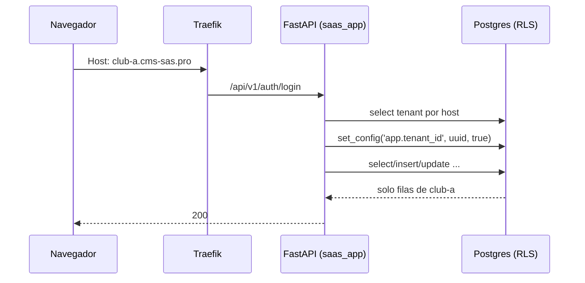

# SaaS multi-tenant para clubes

Infraestructura generada por `generate_infra.py`. El aislamiento entre clubes
no es organizativo: esta impuesto por Postgres.

## Arquitectura

| Capa | Componente | Rol |
|---|---|---|
| Borde | Traefik 3.7 | TLS wildcard por DNS-01, dominios propios, ruteo por Host |
| API | FastAPI + SQLAlchemy async | Rol `saas_app`, RLS activo |
| Worker | ARQ + Redis (broker) | Mismo rol `saas_app`, mismo aislamiento |
| Datos | Postgres 18 (+ extensiones opcionales) | RLS por `tenant_id` + 3 roles |
| Cache | Redis (instancia aparte) | `allkeys-lru`, separada del broker |
| Storage | MinIO / S3 / R2 | Prefijo `tenants/<tenant_id>/...` |

### Aislamiento de datos

La resolucion del club es por `Host`, y despues cada request fija
`app.tenant_id` con `set_config(..., is_local => true)` dentro de su
transaccion. Las policies de RLS comparan `tenant_id` contra ese valor:



Tres roles, con privilegios deliberadamente distintos:

| Rol | Uso | RLS | Superuser |
|---|---|---|---|
| `cms_sas_root` | bootstrap de Postgres | — | si |
| `saas_migrator` | solo Alembic (duenio del esquema) | saltea (es owner) | no |
| `saas_app` | API y worker | **no puede saltear** | no |
| `saas_platform` | alta de clubes y dominios | `BYPASSRLS` | no |

`tenant_users` y `tenant_credentials` tienen RLS. `tenants` y `tenant_domains`
quedan globales (hay que resolver el host antes de saber el club) y a
`saas_app` se le revoca la escritura sobre ellas.

## Dominios y ambientes

Todo sale del mismo dominio base (`SAAS_BASE_DOMAIN`: `cms-sas.localhost` en
desarrollo, `cms-sas.pro` en produccion). El borde reparte por `Host`:

| Host | Que sirve | Routers |
|---|---|---|
| `<base>` (apex) | la landing de la plataforma | `saas-apex-web/api` |
| `admin.<base>` | el backoffice de plataforma (`/admin`) | `saas-admin-web/api` |
| `<slug>.<base>` | el club | `saas-wildcard-web/api` (uno solo para todos) |
| dominio propio del club | el club, anunciado por `X-Saas-Tenant` | `tenant-<slug>-<host>-web/api` |

`admin` es un **label reservado**: `RESERVED_LABELS` en `backend/app/tenancy.py`
(espejado en `frontend/lib/tenant.ts`) tiene `admin`, `www`, `api` y `app`. Un
host con esos labels no resuelve club, no se puede usar como slug y no se puede
registrar como dominio propio; el resto de la lista queda guardado para futuros
servicios de la plataforma. Los routers de `admin.<base>` van con prioridad mas
alta que el wildcard (`PRIORITY_ADMIN_WEB`/`_API`), porque el mismo host tambien
matchea `Host(*.<base>)`.

El certificado wildcard (`*.cms-sas.pro`) cubre a los clubes y al backoffice:
no hace falta emitir uno aparte. El apex pide el certificado del dominio base
con `*.base` como SAN (ver `_tls(wildcard=True)`). En produccion alcanza con
apuntar dos registros DNS al servidor: `cms-sas.pro` y `*.cms-sas.pro`.

## Puesta en marcha (desarrollo)

```bash
python3 generate_infra.py --name mi-saas   # --name es obligatorio
                                           # y despues pregunta por las extensiones
docker compose up -d --build
docker compose ps
```

O con el `Makefile` que se genera junto al stack (recomendado):

```bash
make help   # lista los comandos y las URLs de acceso local
make up     # equivale a `docker compose up -d --build`
make urls   # muestra admin.<dominio> y demo.<dominio>
```

Re-correrlo es seguro: no pisa `.env` ni el codigo de la app (para eso esta
`--force`).

`--name` define la identidad del stack y tiene que ser unico si vas a levantar
mas de uno en la misma maquina (es el nombre de proyecto de Compose). De ahi
salen:

* `name:` de los dos compose (el proyecto de Compose);
* los `container_name` de los servicios one-shot (`<nombre>_postgres`,
  `<nombre>_traefik`, ...). `fastapi` y `nextjs` no lo llevan a proposito: en
  produccion van con `deploy.replicas: 2` y Compose no deja escalar un servicio
  con nombre fijo; su nombre lo arma Compose (`<nombre>-fastapi-1`);
* las redes `<nombre>_edge`, `<nombre>_backend` y `<nombre>_data` (y las labels
  de Traefik que las referencian);
* los nombres de las imagenes que construye Compose: `<nombre>-fastapi`,
  `<nombre>-nextjs`;
* `POSTGRES_DB`, `POSTGRES_SUPERUSER`, `MINIO_ROOT_USER` y `S3_BUCKET` del
  `.env.example`, y el prefijo de los dumps (`<nombre>_<fecha>.dump`).

Los guiones se traducen a guiones bajos donde no se admiten (`mi-saas` ->
`mi_saas_postgres`), y el bucket va al reves (`mi_saas` -> `mi-saas`, S3 no
acepta `_`). Lo que **no** cambia: los roles de Postgres (`saas_migrator`,
`saas_app`, `saas_platform`), los nombres de routers de Traefik
(`saas-apex-web`, ...) y los headers/cookies (`X-Saas-Tenant`,
`saas_platform_session`): son contrato de la app (`backend/app`, tests) y del
`.env` ya inicializado, no identidad del deploy.

Ojo: el `.env` existente no se pisa, asi que un stack ya inicializado sigue
apuntando a su base y su bucket viejos aunque cambies el nombre.

URLs:

* `http://cms-sas.localhost` — apex: la landing de la plataforma.
* `http://admin.cms-sas.localhost/admin` — backoffice de plataforma.
* `http://demo.cms-sas.localhost` — club de ejemplo (`*.localhost` resuelve a
  127.0.0.1 en Chrome/Edge; si usas otro browser, agregalo a `/etc/hosts`).
* `http://localhost:8080` — dashboard de Traefik (solo loopback).
* `http://127.0.0.1:9001` — consola de MinIO (`127.0.0.1:9000` es la API S3,
  para `mc`/`aws` desde tu maquina).
* `127.0.0.1:5432`, `127.0.0.1:6379` y `127.0.0.1:6380` — Postgres y los dos
  Redis, para `psql`/DBeaver y `redis-cli`. Los puertos de los servicios de
  datos los publica Traefik en loopback: la red `data` es interna y Docker no
  publica puertos de contenedores que solo estan en redes internas.
* `http://demo.cms-sas.localhost/api/docs` — OpenAPI.

Si el puerto 80 ya esta ocupado, definí `TRAEFIK_HTTP_PORT` en el `.env` y
agregalo a mano en las URLs (`http://demo.cms-sas.localhost:8090`).

Probar el aislamiento a mano:

```bash
# login del club de ejemplo
curl -s -X POST http://demo.cms-sas.localhost/api/v1/auth/login \
  -H 'Content-Type: application/json' \
  -d '{"email":"admin@demo.cms-sas.localhost","password":"<FIRST_TENANT_ADMIN_PASSWORD>"}'

# el mismo email en otro host: 404, el club no existe
curl -s -o /dev/null -w '%{http_code}\n' -X POST http://otro.cms-sas.localhost/api/v1/auth/login \
  -H 'Content-Type: application/json' -d '{"email":"admin@demo.cms-sas.localhost","password":"x"}'

# rutas que Traefik esta sirviendo desde el provider file
docker compose exec traefik cat /etc/traefik/dynamic/routes.yml
```

## Extensiones de Postgres

La primera vez que corrés un proyecto el generador **pregunta** si querés sumar
extensiones de Postgres (hoy hay una: **PostGIS**). La respuesta queda en
`POSTGRES_EXTENSIONS` del `.env`, que es la memoria de la decisión:

* sin flags y con la clave ya en el `.env`: no vuelve a preguntar, usa esa;
* con `--extensions postgis` / `--no-extensions`: manda el flag (y el `.env` se
  actualiza para no contradecirlo);
* sin `.env`, sin flags y sin terminal (CI, script, pipe): no pregunta y no
  habilita nada.

```bash
python3 generate_infra.py --name mi-saas --extensions postgis
```

### PostGIS

* **Imagen**: con PostGIS habilitado los tres servicios que usan Postgres
  (`postgres`, `db-roles` y `postgres-backup`) pasan de `postgres:18.6-alpine` a
  `postgis/postgis:18-3.6-alpine`, o sea PostgreSQL 18.6 + PostGIS 3.6.4
  (verificado contra el registry, 2026-10). Ojo: el tag no fija los patch,
  arrastra 18.x y 3.6.x.
* **Instalación**: `docker/postgres/roles.sh` corre como superusuario en cada
  `up` y hace `CREATE EXTENSION IF NOT EXISTS postgis`. Por eso la extensión
  también entra en un **clúster ya inicializado**: cambiás la respuesta, corrés
  el generador y `docker compose up -d` (es la misma versión de Postgres, el
  volumen y los datos no se tocan).
* **Grants**: `spatial_ref_sys` y las vistas `geometry_columns` /
  `geography_columns` las crea el superusuario, así que no las cubre el
  `ALTER DEFAULT PRIVILEGES` (que solo aplica a lo que crea el migrador). El
  script les da `SELECT` a `saas_app` y `saas_platform`: sin eso `ST_Transform` y
  los visores GIS fallan para la API. Escribir geometría no necesita nada extra
  (`saas_migrator` hace el DDL y el tipo es `USAGE` para todos).
* **La imagen oficial agrega de más**: en el primer `initdb` su entrypoint crea
  además `postgis_topology`, `postgis_tiger_geocoder` y `fuzzystrmatch`, y la
  base `template_postgis`. Son inofensivas (la app solo tiene `USAGE` sobre
  `public`) y vienen con la imagen; un `\dx` mínimo pide una imagen propia
  (`apk add postgis` sobre `postgres:18.6-alpine`).
* Los backups salen del mismo `pg_dump` 18.6, así que restaurar una tabla con
  geometría no necesita nada aparte.

## Alta de un club

```bash
TOKEN=$(curl -s -X POST http://localhost/api/v1/platform/auth/login \
  -H 'Content-Type: application/json' \
  -d '{"email":"<PLATFORM_ADMIN_EMAIL>","password":"<PLATFORM_ADMIN_PASSWORD>"}' \
  | python3 -c 'import json,sys; print(json.load(sys.stdin)["access_token"])')

curl -s -X POST http://localhost/api/v1/platform/tenants \
  -H "Authorization: Bearer $TOKEN" -H 'Content-Type: application/json' \
  -d '{"slug":"club-norte","name":"Club Norte","admin_email":"admin@club-norte.cms-sas.pro","admin_password":"<password>"}'
```

El alta ya deja `club-norte.cms-sas.pro` ruteando: los subdominios del dominio
base los cubre un router wildcard, no hace falta tocar Traefik.

### Dominio propio (`clubnorte.com.ar`)

```bash
curl -s -X POST http://localhost/api/v1/platform/tenants/<tenant_id>/domains \
  -H "Authorization: Bearer $TOKEN" -H 'Content-Type: application/json' \
  -d '{"host":"clubnorte.com.ar"}'
```

Esto reescribe `routes.yml` y Traefik recarga solo. Despues hay que apuntar el
DNS del dominio al servidor; el certificado lo emite el resolver por DNS-01.

## Produccion

```bash
docker compose -f docker-compose.yml -f docker-compose.prod.yml up -d --build
```

Antes, en el `.env`:

* `SAAS_BASE_DOMAIN=cms-sas.pro` (tu dominio real).
* `ACME_EMAIL` y `ACME_DNS_PROVIDER` + credenciales del provider DNS.
  **DNS-01 es obligatorio**: es el unico desafio que permite emitir el
  wildcard `*.cms-sas.pro`. Con `httpChallenge` no se puede.
* Cambiar todos los secretos. `--force` rota los del `.env`, pero entonces hay
  que correr `docker compose up -d` para que `db-roles` actualice la base.

En produccion no se publica ningun puerto de datos y el dashboard queda
apagado. Las metricas de Prometheus viven en el puerto interno 8080 de Traefik:
para scrapearlas, sumá tu Prometheus a la red `cms_sas_edge`.

## Backups

`postgres-backup` corre `pg_dump --format=custom` cada `BACKUP_INTERVAL_SECONDS`
y borra lo mas viejo que `BACKUP_RETENTION_DAYS`. Los dumps quedan en
`./backups`.

```bash
docker compose exec postgres-backup sh -c 'ls -lh /backups'
docker compose exec postgres-backup pg_restore --list /backups/cms_sas_<fecha>.dump
```

Es backup logico, no PITR. Si necesitas recuperar punto en el tiempo, el camino
es WAL archiving (pgBackRest) al mismo object storage. Ademas: los dumps no
cubren los objetos de S3/MinIO.

### Restore

El dump se hace con `--no-privileges`, asi que un `pg_restore --clean` **no**
restaura los `GRANT`/`REVOKE`: `saas_app` recupera escritura sobre el registro
global (`tenants`, `tenant_domains`) y sobre `platform_users` (las policies de
RLS si sobreviven). Despues de cada restore hay que volver a aplicar el
hardening, que es idempotente:

```bash
DC="docker compose -f docker-compose.yml -f docker-compose.prod.yml"

# 1) detener escrituras
$DC stop fastapi arq-worker
# 2) restaurar (rol migrator, que ve todo)
$DC exec -T postgres-backup pg_restore --clean --if-exists \
  -d "$DATABASE_URL" /backups/<archivo>.dump
# 3) re-aplicar ACLs y blindaje de RLS (corre como superusuario)
$DC exec -T postgres sh -c \
  'psql -U "$POSTGRES_USER" -d "$POSTGRES_DB" -v ON_ERROR_STOP=1 -f -' \
  < docker/postgres/post-restore.sql
# 4) levantar y verificar
$DC up -d
$DC exec fastapi curl -fsS http://127.0.0.1:8000/ready
```

`post-restore.sql` termina con un canario: aborta si alguna tabla del schema
`public` con columna `tenant_id` quedo sin RLS. En desarrollo, ademas:
`docker compose run --rm fastapi pytest -q tests/test_rls.py`.

## Lo propio de cada club (branding y assets)

La app es una sola (una imagen, un deploy) y se ve distinta en cada club. Lo que
cambia no es el codigo, es el **club que resolvio Traefik** a partir del `Host`.
Tres piezas, y ninguna vive en el frontend:

* **una fila por club** en una tabla con `tenant_id` (`tenant_branding`,
  `tenant_assets`), con RLS como el resto;
* **un objeto por club** en el storage, bajo `tenants/<tenant_id>/...`;
* **una ruta tenant-scoped** que lo sirve: el club sale del `Host`, asi que la URL
  es la misma para todos los clubes y el contenido no.

### Branding: nombre y color

| Ruta | Quien | Que hace |
|---|---|---|
| `GET /api/v1/branding` | publico | `{tenant, display_name, primary_color, logo_url}` |
| `PUT /api/v1/branding` | admin del club | nombre visible y `#rrggbb` |
| `GET /tenant-branding` | interno | lo mismo, para el SSR (sin `/api`: el borde no lo enruta) |

El frontend lo lee en el layout (`frontend/lib/branding.ts`): el SSR le pide el
branding al endpoint interno pasando el `Host` del request en `X-SaaS-Host`, y
aplica nombre, logo y `--brand` (el color como variable CSS).

Ademas de `/tenant-branding`, `app/main.py` monta **alias internos sin `/api`**
de los routers de club (`/auth/*` y los modulos, ej. `/articles`), todos con
`include_in_schema=False`. Existen porque el SSR de Next no tiene el `Host` del
navegador y lo manda en `X-SaaS-Host`: `_request_host` confia en ese header solo
para las rutas internas (o en desarrollo). En `/api` manda unicamente el `Host`
real, asi que un cliente externo no puede declararse otro club con un header
propio. La garantia es de red: el borde enruta **exclusivamente** `/api` y el
servicio `fastapi` no publica puertos. Si algun deploy publicara el 8000, ese
supuesto se rompe y hay que firmar el header con `JWT_SECRET` antes de seguir.

### Assets: cualquier archivo por club

El logo es simplemente el asset llamado `logo`; lo mismo sirve para un favicon,
una imagen de la landing o un PDF.

| Ruta | Quien | Que hace |
|---|---|---|
| `GET /api/v1/assets` | publico | lista los assets del club (`name`, `url`, `content_type`, `size_bytes`) |
| `GET /api/v1/assets/<nombre>` | publico | sirve el archivo del club del `Host` (404 si no lo subio) |
| `PUT /api/v1/assets/<nombre>` | admin del club | alta o reemplazo (png/jpeg/webp/svg/ico/pdf, hasta 2 MB) |
| `DELETE /api/v1/assets/<nombre>` | admin del club | borra fila y objeto |

```bash
TOKEN=$(curl -s -X POST http://127.0.0.1/api/v1/auth/login -H 'Host: demo.cms-sas.localhost' \
  -H 'Content-Type: application/json' \
  -d "{\"email\":\"$FIRST_TENANT_ADMIN_EMAIL\",\"password\":\"$FIRST_TENANT_ADMIN_PASSWORD\"}" \
  | python3 -c 'import json,sys; print(json.load(sys.stdin)["access_token"])')

# nombre visible y color
curl -s -X PUT http://127.0.0.1/api/v1/branding -H 'Host: demo.cms-sas.localhost' \
  -H "Authorization: Bearer $TOKEN" -H 'Content-Type: application/json' \
  -d '{"display_name":"Auxilio RB","primary_color":"#22c55e"}'

# logo (es el asset "logo") y cualquier otro archivo
curl -s -X PUT http://127.0.0.1/api/v1/assets/logo -H 'Host: demo.cms-sas.localhost' \
  -H "Authorization: Bearer $TOKEN" -F 'file=@logo.png;type=image/png'
curl -s -X PUT http://127.0.0.1/api/v1/assets/favicon -H 'Host: demo.cms-sas.localhost' \
  -H "Authorization: Bearer $TOKEN" -F 'file=@favicon.ico;type=image/x-icon'

# lo publico: lo que ve el navegador de ese club
curl -s -H 'Host: demo.cms-sas.localhost' http://127.0.0.1/api/v1/branding
curl -s -H 'Host: demo.cms-sas.localhost' http://127.0.0.1/api/v1/assets
curl -s -o /dev/null -w '%{http_code} %{content_type}\n' \
  -H 'Host: demo.cms-sas.localhost' http://127.0.0.1/api/v1/assets/logo
```

Para agregar otro tipo de archivo por club, el camino es el mismo: **una fila con
`tenant_id` (RLS) + un objeto bajo `tenants/<tenant_id>/...` + una ruta que
resuelve el club por `Host`**. Lo que NO se hace es ramificar por slug en el
codigo del frontend: el slug solo sirve para decidir que pedir, nunca para
autorizar.

## Sitios por club (apps de UI)

Un **sitio** es la UI completa de un club, servida por la misma app Next (una
imagen, un deploy) al lado del shell de la plataforma. No es un proyecto aparte
ni un router por club: la app sigue siendo una sola y el club sale del request
(`Host` o el header del borde), igual que en el branding. La diferencia es la
profundidad del cambio: el branding cambia nombre y color, un sitio cambia el
arbol de componentes.

La costura vive en `frontend/lib/sites.ts` (`ClubSite`, `SITES`, `siteForClub`,
`requestClub` y `requireSite`) y se enchufa en tres lugares de la app:

| Archivo | Que decide |
|---|---|
| `frontend/app/layout.tsx` | el `<html>`/`<body>`: el chrome y el `<head>` del sitio, o el shell de la plataforma. Los metadatos y el viewport salen de `generateMetadata`/`generateViewport` |
| `frontend/app/page.tsx` | la home: la del sitio, o la de la plataforma |
| `frontend/app/not-found.tsx` | el 404: el del sitio, o el minimo de la plataforma (que tambien cubre los 404 de `/admin` en el host de un club) |

Instalar un sitio es agregar codigo propio y registrar una entrada; la infra no
se toca:

1. copiar su codigo a `frontend/src/<sitio>/` y sus assets a una carpeta propia
   bajo `frontend/public/`;
2. exportar un `ClubSite` (de que club es, metadatos, viewport, `<head>`, chrome,
   home y 404) y sumarlo a `SITES` en `frontend/lib/sites.ts`;
3. poner sus rutas en un route group (`frontend/app/(<sitio>)/<ruta>/page.tsx`)
   con un `layout.tsx` que llame a `requireSite('<id>')`: el grupo no aparece en
   la URL, y en el host de cualquier otro club esas rutas son 404. Del chrome y
   los metadatos de todas las rutas se sigue encargando el layout raiz.

El generador deja instalado el sitio del tenant de ejemplo (Auxilio RB); el
resto de los clubes usa el shell de la plataforma. Tambien emite
`frontend/app/not-found.tsx`, asi que el 404 por defecto de Next queda
reemplazado por el minimo de la plataforma mas la rama que le da el sitio al
mismo club.

Los 404 y el status: el chrome del sitio (`AuxilioShell`) se renderiza en el
servidor, asi que el 404 del sitio conserva el status que mando Next. Una ruta
que no existe (`/no-existe`) responde `404` y, en el host del club, muestra el
404 del sitio. El backoffice sigue inaccesible desde el host del club.

`frontend/tsconfig.json` deja `noUncheckedIndexedAccess` apagado (lo unico que
baja respecto de `strict`): un sitio es codigo portado de su propio repo, y
encender el flag obliga a reescribirlo entero aca adentro (o a mantenerlo
desincronizado). El resto —`strict`, `noUnusedLocals`, `noUnusedParameters`—
sigue igual, y `npm run typecheck` valida la plataforma y los sitios juntos: el
build de produccion corre ese typecheck antes de `next build`.

### Auxilio RB (`auxiliosrb`)

El tenant de ejemplo se genera con la landing de Auxilio RB ya instalada. Su
codigo vive en `frontend/src/auxiliosrb/**`:

* `site.tsx`: descriptor `ClubSite` (club `demo`, metadatos, viewport, fuentes,
  shell, home y 404). El slug sale de `FIRST_TENANT_SLUG`.
* `AuxilioHome.tsx`: la landing (componente de cliente): header, hero,
  artículos, servicios, cobertura, mapa y contacto. La seccion de artículos
  conserva filtros por categoria, artículo destacado, grid y vista de artículo, y
  **consume el modulo `articles`** (`GET /api/v1/articles`). Si el modulo esta
  apagado (404) la seccion y su link del menu desaparecen: no hay contenido
  local de reserva.
* `styles/auxiliosrb.css`: la hoja del sitio (clases `ax-*`, resets bajo
  `.auxiliosrb-app`). Se importa desde `app/layout.tsx`, asi que no toca el
  shell de la plataforma ni el backoffice.

Los assets (`logo.webp`, `f1.webp`, `f3.webp`, `f4.webp`, `f6.webp`,
`f8.webp`, `favicon.svg`) se copian desde `assets/auxiliosrb/` (al lado de este
generador) a `frontend/public/auxiliosrb/` y se sirven estaticos desde
`/auxiliosrb/...`. El sitio no lee el branding ni el estado del club, y los datos
de contacto (WhatsApp y telefono) estan en la landing. Los artículos salen de la
API del modulo `articles`; el resto del contenido sigue siendo codigo del sitio.

Para moverlo a otro club, cambia `club` en `site.tsx` por el slug
correspondiente, o agrega otra entrada a `SITES`. Los assets se pueden
reemplazar por los del club real: el generador no los pisa salvo con
`--force`.

### ElaTech (`elatech`)

Sitio portado desde la landing propia de ElaTech (Vite + Tailwind v3) a
`frontend/src/elatech/**`:

* `site.tsx`: descriptor `ClubSite` (club `elatech`, metadatos, viewport,
  fuentes, shell, home y 404). El shell tambien monta el widget de chatbot que
  traia el `index.html` de la landing, cargado con `next/script` despues de la
  hidratacion.
* `ElatechHome.tsx`: pide una sola vez `GET /api/v1/articles` y reparte por
  categoria. **Capacitaciones** y **Proyectos** no son contenido local: son las
  artículos del club filtradas por `Capacitación` y `Proyectos` (se comparan sin
  acentos ni mayusculas, porque la categoria la escribe el club en el panel). Si
  el modulo `articles` esta apagado (404) o la API no responde, los dos bloques y
  sus links del menu desaparecen. Los artículos iniciales se cargaron con el
  contenido que la landing tenia hardcodeado.
* `styles/elatech.css`: Tailwind v4 **sin preflight global** (se importa desde
  `app/layout.tsx`): solo `theme` + `utilities`, con los resets, la tipografia
  editorial y `page-container` acotados a `.elatech-app`. Los tokens propios
  viven bajo ese contenedor para no pisar los del backoffice.

El asset `logo-e.svg` vive en `frontend/public/elatech/` y se sirve desde
`/elatech/logo-e.svg`.

## Modulos conectables (plugins)

Un **modulo** agrega una funcionalidad completa (tabla, API, UI opcional) a los
clubes, pero **se enciende por club**. El nucleo no sabe que existe: lo monta
`app/main.py` desde el registro y cada router decide si atiende o no segun el
switch.

| Pieza | Archivo | Que hace |
|---|---|---|
| Contrato | `backend/app/modules/base.py` | `Module`: nombre, titulo, router y hook `on_enable` |
| Registro | `backend/app/modules/registry.py` | `MODULES`, catalogo, `set_enabled` (upsert + hook) |
| Estado | `backend/app/modules/state.py` | lectura/escritura de `tenant_modules` (RLS) |
| Gate | `backend/app/modules/gate.py` | `require_public` / `require_admin`: modulo apagado = 404 |
| Tabla | migraciones `0004_modules_news` + `0005_articles` | `tenant_modules (tenant_id, name)` con RLS |

**Fila ausente = apagado.** Un club nuevo no hereda modulos: el switch lo prende
el operador. `GET /api/v1/modules` (tenant-scoped, publico) lista solo los que el
club tiene habilitados; es lo que usa un sitio para decidir que secciones pintar.

### Habilitar y apagar

En el backoffice, ficha del club → **Módulos**. Por API:

```bash
curl -s -X PUT http://127.0.0.1/api/v1/platform/tenants/<tenant_id>/modules/articles \
  -H "Authorization: Bearer $PLATFORM_TOKEN" \
  -H 'Content-Type: application/json' -d '{"enabled": true}'
```

Al habilitar corre `on_enable` del plugin (idempotente). El de `articles` siembra
artículos de ejemplo **solo si el club no tiene ninguno**, asi encender el modulo
no pisa contenido propio. `app/bootstrap.py` habilita `articles` en el club de
ejemplo (el sitio que instala el generador ya trae la seccion).

### Modulo `articles` (artículos)

`tenant_modules` + `articles` (RLS por `tenant_id`, PK `(tenant_id, slug)`). La tabla nace como `news_posts` en `0004` y `0005_articles` la renombra; el modelo pasa a `Article`.

| Ruta | Quien | Que hace |
|---|---|---|
| `GET /api/v1/articles` | publico | publicados; filtros `category` y `limit` |
| `GET /api/v1/articles/<slug>` | publico | un artículo publicado |
| `GET /api/v1/articles/all` | admin del club | todos, incluidos `draft`/`archived` (filtro `status`) |
| `POST /api/v1/articles` | admin del club | alta (`title`, `content`, `category`, `status`, `author`, `excerpt`, `slug?`) |
| `PUT /api/v1/articles/<id>` | admin del club | edicion parcial |
| `DELETE /api/v1/articles/<id>` | admin del club | baja |
| `GET /api/v1/articles/<slug>/image` | publico | imagen del artículo (cache inmutable, versionada) |
| `PUT /api/v1/articles/<id>/image` | admin del club | sube o reemplaza la imagen (`multipart`; png, jpeg, webp, gif o avif; hasta 5 MB) |
| `DELETE /api/v1/articles/<id>/image` | admin del club | borra la imagen |

La imagen es opcional. La fila guarda `image_key`, `image_content_type` e
`image_updated_at` (migracion `0006_article_images`); los bytes viven en el
storage bajo `tenants/<tenant_id>/articles/<article_id>.<ext>`. El payload
expone `image_url` (o `null`) con la version en el query para cachear; reemplazar
la imagen borra el objeto anterior y borrar el artículo borra el suyo. El panel
la sube desde el mismo formulario y permite quitarla con un checkbox.

El slug sale del titulo (o de `slug`) y se desambigua con `-2`, `-3`… dentro del
club. `content` es texto plano con `##`/`###` y listas numeradas, que es lo que
renderiza la landing. La gestion usa el token del club (`POST /api/v1/auth/login`
en el `Host` del club). El admin del club no necesita curl: tiene su panel (ver
*Panel de artículos del club*).

### Agregar un modulo

1. crear `backend/app/modules/<nombre>/` con su modelo (heredando `Base`), su
   router y, si hace falta, `on_enable`;
2. sumar el `Module` a `MODULES` en `registry.py` (el router se monta solo bajo
   `/api/v1`, y sus rutas usan `require_public`/`require_admin`);
3. crear la tabla con RLS en una migracion (`tenant_id` + policy
   `tenant_isolation` + grants a `saas_app`), como `0004_modules_news`;
4. si el sitio lo consume, leer su API y ocultar la seccion cuando responde 404.

## Panel de artículos del club

El admin del club opera sus artículos desde el **host de su club**, no desde el
backoffice:

```
http://demo.cms-sas.localhost/panel/articulos        # login propio del club
```

| Ruta | Que hace |
|---|---|
| `/panel/articulos/login` | login del club (`POST /auth/login` interno, con `?expirado=1` si la sesion cayo) |
| `/panel/articulos` | lista todos (publicados, borradores, archivados) + publicar/despublicar/archivar |
| `/panel/articulos/nueva` | alta (`title`, `slug?`, `category`, `author`, `excerpt`, `content`, `status`, `image?`) |
| `/panel/articulos/<id>` | edicion y baja |

Entra con un usuario **admin del club** (`FIRST_TENANT_ADMIN_EMAIL` en el club de
ejemplo). La sesion es una cookie httpOnly (`saas_club_session`) que escribe una
Server Action; vale lo mismo que el token del club (60 minutos, sin refresh) y no
se refresca: al vencer, cualquier accion manda al login con el aviso. El token
nunca llega al JS del navegador.

Las paginas son server components que llaman a la API por la **red interna**,
con los alias sin `/api` y el `Host` del navegador reenviado en `X-SaaS-Host`
(`frontend/lib/tenant-auth.ts`). El contrato compartido con los formularios
(client) vive en `frontend/lib/club.ts`, sin `next/headers`.

Si el modulo `articles` esta apagado en el club, el panel no rompe: muestra el aviso
y nada mas (la API responde 404 y eso se trata como estado, no como error).

El panel es su propio backoffice: `frontend/proxy.ts` marca `/panel/*` y el
layout raiz lo saca del shell del sitio (`AuxilioShell`), asi que no hereda sus
resets. Usa el mismo design system que `/admin` (`frontend/app/backoffice.css`):
sidebar con el branding del club, tablas, formularios y modo claro/oscuro.

El enlace discreto esta en el footer de la landing del sitio, condicionado al
modulo: **Gestionar artículos** → `/panel/articulos`.

## Backoffice de plataforma

El backoffice sirve para operar la **plataforma** (los clubes), no para operar
un club. Es la misma app Next que sirve a los clubes, bajo `/admin`, y **solo
responde en `admin.<dominio base>`**: en el apex (que es la landing) y en el host
de un club la ruta es 404, porque un admin de plataforma no tiene por que estar
parado en el host de nadie. (En el host de un club que tiene sitio propio, ese
404 es el del sitio y lleva status 200: ver *Sitios por club (apps de UI)*.)

```bash
# desarrollo: http://admin.cms-sas.localhost/admin
# produccion: https://admin.<SAAS_BASE_DOMAIN>/admin
```

Se entra con `PLATFORM_ADMIN_EMAIL` y `PLATFORM_ADMIN_PASSWORD` del `.env`. La
sesion es una cookie httpOnly que escriben las Server Actions: el token de
plataforma nunca llega al JS del navegador, y las mutaciones viajan a la API por
la red interna de Docker.

| Que se puede hacer | Donde |
|---|---|
| Listar clubes (slug, nombre, estado, dominios) | `/admin` |
| Crear un club: club + dominio `<slug>.<base>` + su admin | `/admin/tenants/new` |
| Renombrar y suspender/reactivar | ficha del club. Suspender cierra la API del club (403) y su shell muestra el aviso |
| Alta y baja de dominios propios | ficha del club. Cada cambio reescribe `routes.yml` |
| Usuarios del club: alta con email, password y rol | ficha del club |
| Reset de password (y cambio de rol) de un usuario | ficha del club |
| Habilitar/apagar modulos conectables (hoy `articles`) | ficha del club, seccion Modulos |
| Sincronizar rutas a mano | boton en `/admin` (reescribe `routes.yml`) |
| Dar de baja un club | borra sus filas (`ON DELETE CASCADE`), los objetos bajo `tenants/<tenant_id>/` y sus rutas |

Tabla de endpoints de plataforma (todos `bearer`, scope `platform`):

| Ruta | Que hace |
|---|---|
| `POST /api/v1/platform/auth/login` | `{access_token}` (60 minutos, sin refresh) |
| `GET /api/v1/platform/me` | el admin de plataforma de la sesion |
| `GET /api/v1/platform/tenants` | lista; cada club trae `domains: [{host, is_primary}]` |
| `POST /api/v1/platform/tenants` | alta de club + dominio base + admin del club |
| `GET /api/v1/platform/tenants/{id}` | ficha: datos, `created_at`, usuarios y cuantos assets tiene |
| `PATCH /api/v1/platform/tenants/{id}` | `name` y/o `status` (`active` o `suspended`) |
| `DELETE /api/v1/platform/tenants/{id}` | baja del club (204) |
| `POST /api/v1/platform/tenants/{id}/domains` | agrega dominio propio o del dominio base |
| `DELETE /api/v1/platform/tenants/{id}/domains/{host}` | quita un dominio (nunca el primario) |
| `POST /api/v1/platform/tenants/{id}/users` | alta de usuario del club |
| `PATCH /api/v1/platform/tenants/{id}/users/{user_id}` | reset de password y/o cambio de rol |
| `POST /api/v1/platform/routes/sync` | reescribe `routes.yml` |

La baja del club no toca los backups: si querés conservar los datos, sacá un dump
antes (ver "Backups").

## Tests

```bash
docker compose run --rm fastapi pytest -q
```

Los tests de integracion crean dos clubes, escriben con el rol de la API y
verifican que no se vean entre si, que un `UPDATE` cruzado afecte 0 filas y que
un `INSERT` a nombre de otro club falle por `WITH CHECK`. Si no hay base
disponible, se saltean.

## Notas de operacion

* **Re-correr el generador** no pisa `.env` ni el codigo de `backend/app` y
  `frontend/app`. Si tu `.env` ya existia, le agrega solo las variables que
  faltan (sin tocar las que ya tenias) y te avisa si encuentra placeholders sin
  reemplazar o claves que ya no se usan (por ejemplo `AFIP_CUIT` o `POSTGRES_USER`,
  que ahora son por club o se llaman distinto). `--force` sobrescribe todo y rota
  los secretos del `.env`.
* **El frontend es TypeScript**: `frontend/app` y `frontend/lib` van en `.tsx`/`.ts`
  y `tsconfig.json` corre en `strict` (mas `noUnusedLocals` y
  `noUnusedParameters`; `noUncheckedIndexedAccess` esta apagado, ver *Sitios por
  club (apps de UI)*). `npm run typecheck` (`tsc --noEmit`) valida tipos sin
  compilar, y el build de produccion lo corre antes de `next build`: si los tipos
  no cierran, la imagen no se construye. `next.config.ts` y el alias `@/*` tambien
  son del tsconfig; `allowJs` esta en `false`, asi que los `.js` nuevos no entran.
  Si el proyecto ya venia de la version JavaScript, corré una vez
  `docker compose up -d --build --renew-anon-volumes nextjs`: el volumen anonimo de
  `node_modules` no se renueva solo y si no Next te instala su propio TypeScript.
* **Estilos de los backoffices**: `/admin` y `/panel/*` usan el design system
  compartido (`@mmanto/devbout-ui` + Tailwind v4, con los tokens de
  `devbout-app-template`) importado sólo desde `frontend/app/backoffice.css`. El
  sitio público de los clubes no carga esa hoja. `frontend/proxy.ts` marca
  `/panel/*` para que el layout raíz omita `site.Shell`: sin eso, los resets
  unlayered del sitio le ganarían a las utilidades de Tailwind. Al sumar o
  cambiar dependencias del frontend, renová el volumen anónimo de
  `node_modules` (`docker compose up -d --build --renew-anon-volumes nextjs`) o
  el contenedor sigue usando el `node_modules` viejo.
* **El club del request no se pregunta**: `frontend/lib/tenant.ts` lo resuelve, en
  orden, desde `SAAS_TENANT` (instancia dedicada a un club), el header
  `X-Saas-Tenant` que inyecta Traefik en los routers de dominio propio, o el
  subdominio de `SAAS_BASE_DOMAIN` (salvo los labels reservados: `admin.<base>` no
  es un club). Los routers del dominio base **vacian** ese header a proposito
  (`backend/app/provisioning.py`), asi que un cliente no puede declararse otro
  club. Las llamadas a `/api/v1/...` no llevan el tenant: el backend lo resuelve
  por `Host` (`tenant_domains` → slug) y aísla con RLS.
* **Una app por club (opcional)**: la misma imagen sirve para todos los clubes; si
  querés una instancia dedicada (white-label o un deploy aparte), sumá un servicio
  con `SAAS_TENANT=<slug>` y su router. Con `SAAS_TENANT` seteado el frontend no
  deduce nada: es *ese* club.
  ```yaml
  nextjs-lasquintas:
    build: { context: ./frontend, dockerfile: Dockerfile.dev }
    container_name: cms_sas_nextjs_lasquintas
    environment:
      SAAS_TENANT: lasquintas
      INTERNAL_API_URL: http://fastapi:8000
      NEXT_PUBLIC_API_BASE: /api
    volumes:
      - ./frontend:/app
      - /app/node_modules
      - /app/.next
    networks:
      - edge
    labels:
      - "traefik.enable=true"
      - "traefik.docker.network=cms_sas_edge"
      - "traefik.http.services.nextjs-lasquintas.loadbalancer.server.port=3000"
      - "traefik.http.routers.nextjs-lasquintas.rule=Host(`lasquintas.localhost`)"
      - "traefik.http.routers.nextjs-lasquintas.entrypoints=web"
      # 200: le gana al router de dominio propio (150) del provider file.
      - "traefik.http.routers.nextjs-lasquintas.priority=200"
  ```
  El dominio tiene que estar registrado en `tenant_domains` igual: es lo que usa la
  API para saber de quien es el host.
* **Rotar los secretos del `.env` (`--force`) no actualiza lo ya inicializado**:
  * **Postgres**: `POSTGRES_SUPERUSER_PASSWORD` se aplica una sola vez, al crear el
    cluster en `postgres_data`. Con datos ya cargados, el one-shot `db-roles` falla
    con `password authentication failed for user`. Sincronizá el rol con el password
    nuevo del `.env` (por el socket local la auth es `trust`, no hace falta el viejo):
    ```bash
    SU=$(grep -m1 '^POSTGRES_SUPERUSER=' .env | cut -d= -f2-)
    DB=$(grep -m1 '^POSTGRES_DB=' .env | cut -d= -f2-)
    docker compose exec postgres psql -U "$SU" -d "$DB" \
      -c "ALTER ROLE $SU WITH PASSWORD '$(grep -m1 '^POSTGRES_SUPERUSER_PASSWORD=' .env | cut -d= -f2-)'"
    ```
  * **Usuarios del bootstrap** (`PLATFORM_ADMIN_PASSWORD`, `FIRST_TENANT_ADMIN_PASSWORD`):
    en la DB queda el *hash* del password viejo, así que el login devuelve 401. Rehasheá
    el que corresponda (`platform_users` o `tenant_users`):
    ```bash
    SU=$(grep -m1 '^POSTGRES_SUPERUSER=' .env | cut -d= -f2-)
    DB=$(grep -m1 '^POSTGRES_DB=' .env | cut -d= -f2-)
    PW=$(grep -m1 '^PLATFORM_ADMIN_PASSWORD=' .env | cut -d= -f2-)
    HASH=$(docker compose exec -T -e PW="$PW" fastapi \
      python -c "import os; from app.security import hash_password; print(hash_password(os.environ['PW']))")
    printf "UPDATE platform_users SET password_hash = :'h' WHERE email = '%s';\n" \
      "$(grep -m1 '^PLATFORM_ADMIN_EMAIL=' .env | cut -d= -f2-)" |
      docker compose exec -T postgres psql -U "$SU" -d "$DB" -v h="$HASH"
    ```
  * **`CREDENTIALS_KEY`**: las credenciales ya cifradas en `tenant_credentials` dejan de
    descifrarse (hay que volver a cargarlas por `PUT /api/v1/credentials/...`).
    **`JWT_SECRET`**: las sesiones emitidas antes quedan inválidas (los usuarios vuelven
    a loguearse).
  * Empezar de cero: `docker compose down -v` (borra los datos).
* **`AFIP_CUIT` y compañía ya no van al `.env`**: son por club y se cargan en
  `tenant_credentials` via `PUT /api/v1/credentials/afip`.
* **`pyafipws` no se instala**: es Python 2 (`print "..."` en su `setup.py`) y
  la version `2.8.0` no existe en PyPI. El cliente de ARCA se implementa en la
  app; el material de firma ya queda guardado cifrado por club.
* **No subir `redis-py` a 8.x** mientras sigas con ARQ: `arq` declara `redis<6`.
* Traefik monta el socket de Docker en solo lectura. Si querés endurecer mas,
  pone un `docker-socket-proxy` delante y sacá el socket.
